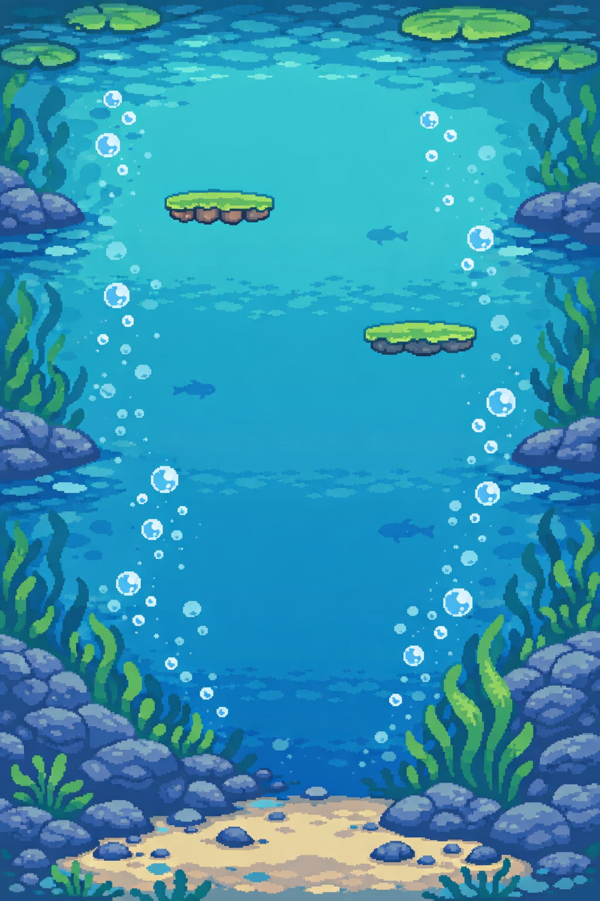
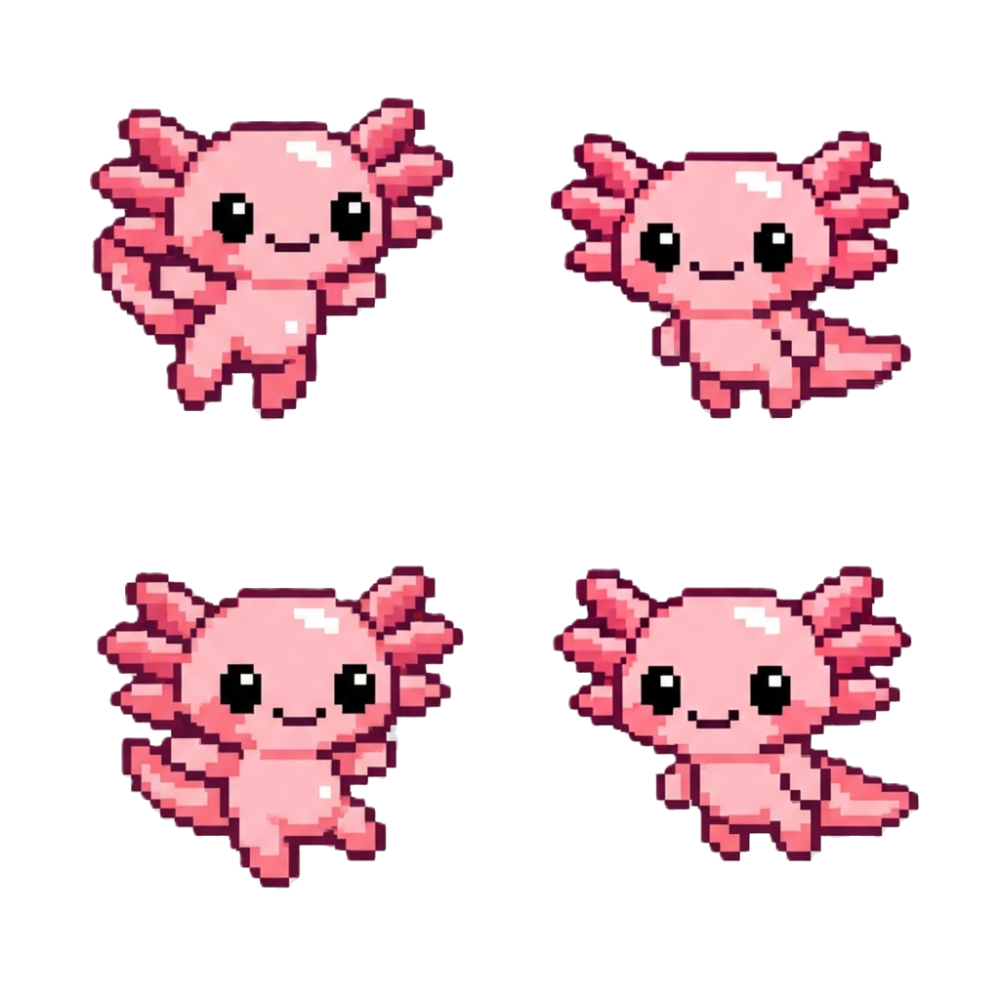
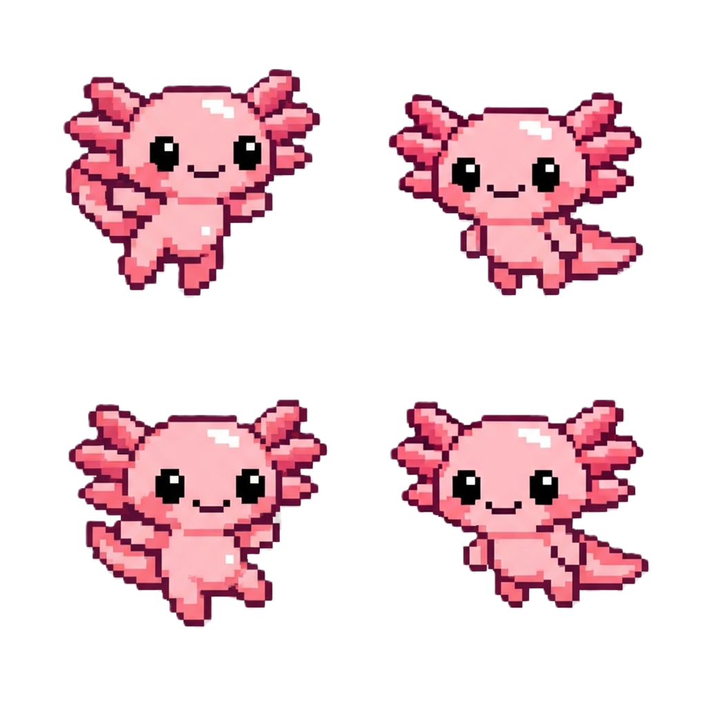
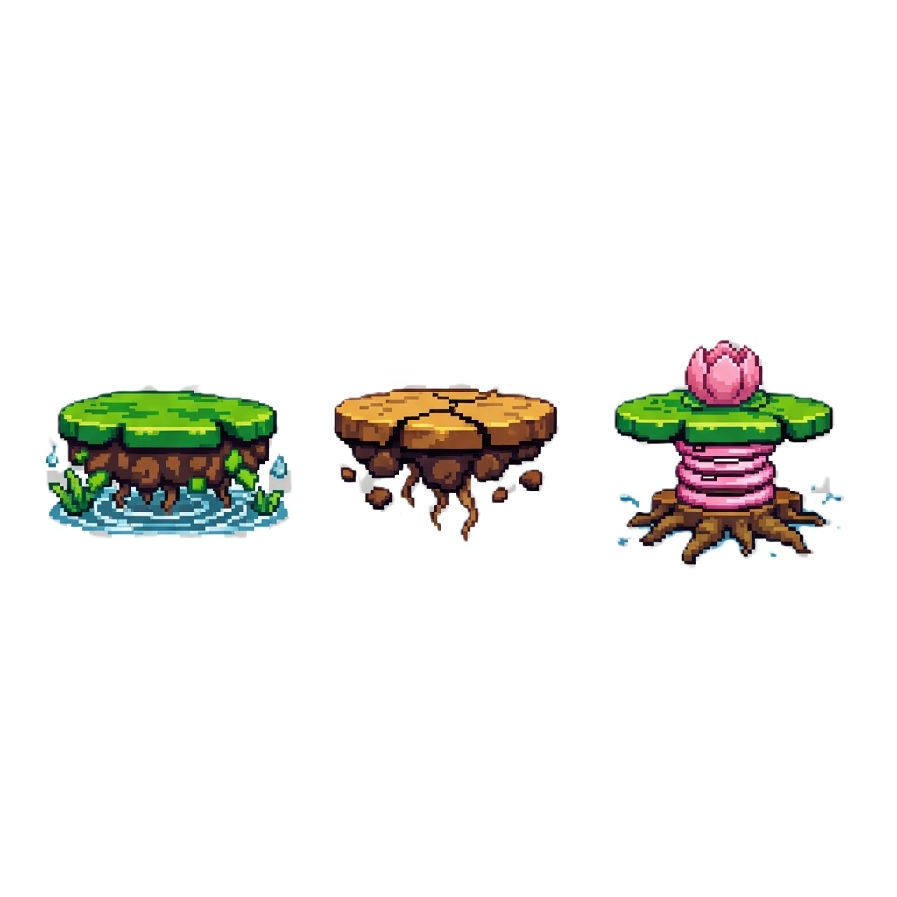

<div align="center">

# 🫧 Axolotl Jumper

### A cheerful endless-jumping adventure beneath the water

[](https://bartandrew.github.io/Axolotl_Jumper/)

**[▶ Play the game in your browser](https://bartandrew.github.io/Axolotl_Jumper/)**

<br>



</div>

---

## 🌊 About the Game

**Axolotl Jumper** is a browser-based endless jumper starring a cheerful little axolotl exploring an underwater world.

The goal is simple: **keep climbing**.

Your axolotl automatically bounces from platform to platform while you steer left and right. The higher you travel, the more challenging the climb becomes. Along the way you'll encounter normal lily pads, fragile cracked platforms, powerful spring platforms, collectible bubbles, moving hazards, and an ever-rising score.

The game is deliberately easy to understand but increasingly difficult to master — designed to be fun for kids while also serving as a compact example of how a complete HTML5 game can be built with JavaScript and Canvas.

<div align="center">

### 🎮 [PLAY AXOLOTL JUMPER](https://bartandrew.github.io/Axolotl_Jumper/)

No download required — open the link and start jumping.

</div>

---

## 🦎 Meet the Axolotl

<div align="center">



*The current Axolotl Jumper character sprite sheet.*

</div>

The hero is a friendly pixel-art axolotl with oversized external gills, a bright expression, and a four-frame animated movement cycle.

The character was designed to feel:

- **Friendly** — instantly approachable for younger players.
- **Readable** — easy to see against the underwater background.
- **Playful** — exaggerated proportions give the character personality.
- **Animated** — multiple poses make every jump feel alive.
- **Distinctive** — the axolotl gives the game its own identity instead of feeling like a generic platform jumper.

### 🎨 Character development

Like the game itself, the character artwork evolved during development.

<table>
<tr>
<td width="50%" align="center">
<strong>Earlier character artwork</strong><br><br>

</td>
<td width="50%" align="center">
<strong>Current character artwork</strong><br><br>

</td>
</tr>
</table>

The newer artwork supports the game's animated sprite system and fits the colourful underwater world more consistently.

---

## 🕹️ How to Play

The axolotl **jumps automatically**. Your job is to steer.

### Desktop

| Action | Controls |
|---|---|
| Move left | **← Left Arrow** or **A** |
| Move right | **→ Right Arrow** or **D** |
| Jump | Automatic |
| Restart | Press **AGAIN** after Game Over |

### Mobile / Tablet

- Tap or hold the **left side** of the screen to move left.
- Tap or hold the **right side** of the screen to move right.
- Release to stop steering.
- Jumping happens automatically.

### The objective

1. Land on platforms.
2. Keep moving upward.
3. Use spring platforms for extra height.
4. Collect bubbles for a boost and bonus points.
5. Avoid hazards.
6. Don't fall below the bottom of the screen.
7. Beat your best score.

> **Tip:** You can wrap around the edge of the screen. Moving completely off one side brings the axolotl back from the opposite side.

---

## 🍃 Platform Guide

<div align="center">



</div>

The climb is built from several platform types:

| Platform | Behaviour |
|---|---|
| 🟢 **Normal lily pad** | Your reliable everyday platform. Land on it and bounce upward. |
| 🟤 **Cracked lily pad** | Breaks after you land on it, so keep moving. |
| 🌀 **Spring platform** | Launches the axolotl much higher than a normal jump. |

As your score rises, platform gaps become larger and cracked platforms become more common.

---

## ✨ Power-ups & Hazards

### 🫧 Bubble boost

Collect floating bubbles to receive:

- an immediate upward boost;
- particle effects and sound;
- **+200 bonus points**.

### 🔴 Underwater hazards

Moving hazards begin appearing during the climb. Touching one ends the run immediately, so sometimes the safest platform isn't the most direct one.

---

## 📈 Scoring & Difficulty

Your score is primarily based on **how high you've climbed**.

As the camera moves upward:

- your score increases;
- platform spacing gradually expands;
- cracked platforms become more common;
- hazards become more likely;
- the HUD displays an increasingly higher level.

Your best score is saved locally in the browser using `localStorage`, so you can return later and try to beat it.

---

## 🖼️ The Underwater World

<div align="center">


</div>

The background uses a scrolling underwater illustration that moves at a different speed from the gameplay layer, creating a subtle **parallax effect** and giving the endless climb more depth.

The game combines:

- colourful underwater scenery;
- pixel-art character animation;
- lily-pad platform sprites;
- particles;
- sound effects;
- looping background music;
- bubbles and hazards.

---

## 🧠 How It Works

Axolotl Jumper is intentionally lightweight. Most of the game lives inside a single `index.html` file and uses the browser's built-in technologies.

### Core technologies

- **HTML5 Canvas** for game rendering
- **Vanilla JavaScript** for the game engine
- **CSS** for menus and HUD styling
- **Web Audio API** for generated sound effects
- **HTML Audio** for background music
- **Local Storage** for the high score
- **Progressive Web App (PWA)** support
- **Service Worker** for offline caching
- **GitHub Pages** for hosting

No game engine or JavaScript framework is required.

---

## ⚙️ Game Architecture

The main game loop runs with `requestAnimationFrame()` and performs several jobs every frame:

1. **Read input** from keyboard or touch controls.
2. **Apply physics** including horizontal movement and gravity.
3. **Detect collisions** between the axolotl and platforms.
4. **Handle platform effects** such as cracked pads and springs.
5. **Update power-ups and hazards**.
6. **Scroll the camera** as the player climbs.
7. **Generate new platforms** above the visible screen.
8. **Remove old objects** below the play area.
9. **Update animation and particles**.
10. **Render the world** to the Canvas.

The game also increases difficulty based on climbing height, making the world progressively less forgiving.

---

## 📱 Progressive Web App

Axolotl Jumper includes both a `manifest.json` and `service-worker.js`.

That means supported browsers can treat the game more like an installed application:

- launch in standalone mode;
- add it to a device home screen;
- cache game files;
- continue loading previously cached resources offline.

---

## 🚀 Play the Game

<div align="center">

### 👉 **[bartandrew.github.io/Axolotl_Jumper](https://bartandrew.github.io/Axolotl_Jumper/)**

[](https://bartandrew.github.io/Axolotl_Jumper/)

</div>

---

## 💻 Run It Locally

Clone the repository:

```bash
git clone https://github.com/BartAndrew/Axolotl_Jumper.git
cd Axolotl_Jumper
```

Then serve the folder with a small local web server.

For example, with Python:

```bash
python -m http.server 8000
```

Open:

```text
http://localhost:8000
```

Using a local web server is recommended because browser security rules restrict some service-worker features when a page is opened directly from the file system.

---

## 🗂️ Project Structure

```text
Axolotl_Jumper/
├── index.html          # Game, physics, UI and rendering
├── axolotl.png         # Current animated axolotl sprite sheet
├── axolotl-old.png     # Earlier character artwork
├── platforms.png       # Current platform sprite sheet
├── platforms-old.png   # Earlier platform artwork
├── platforms-trans.png # Transparent platform asset
├── background.png      # Underwater background
├── GameMusic.mp3       # Looping background music
├── manifest.json       # PWA metadata
├── service-worker.js   # Offline caching
└── README.md           # Project guide
```

---

## 🔬 Learning Project

Beyond being a game, Axolotl Jumper is a useful small project for learning web game development.

It demonstrates:

- game loops;
- velocity and gravity;
- procedural level generation;
- collision detection;
- camera scrolling;
- parallax backgrounds;
- sprite-sheet animation;
- touch and keyboard controls;
- particles;
- audio;
- persistent browser storage;
- responsive Canvas rendering;
- Progressive Web Apps;
- offline caching.

Because there are no external engine dependencies, the code can be opened and studied directly.

---

## 🛠️ Ideas for Future Development

Possible directions for future versions include:

- additional axolotl characters and skins;
- themed underwater biomes;
- more platform types;
- enemies and friendly sea creatures;
- collectible pearls;
- temporary shields and special abilities;
- achievements;
- multiplayer or shared leaderboards;
- richer character animation;
- boss or challenge stages;
- difficulty modes;
- accessibility options.

---

## ❤️ Project Philosophy

Axolotl Jumper started from a simple idea:

> **Make something playful, approachable and fun — then use it as a place to experiment with game design and web technology.**

The result is a small game that can be played immediately in a browser, enjoyed by kids, and pulled apart by anyone interested in learning how browser games work.

<div align="center">

<br>

## 🫧 Ready to jump?

### **[🎮 PLAY AXOLOTL JUMPER](https://bartandrew.github.io/Axolotl_Jumper/)**

<br>

Built with HTML, JavaScript, Canvas, pixel art and one very determined axolotl.

</div>
